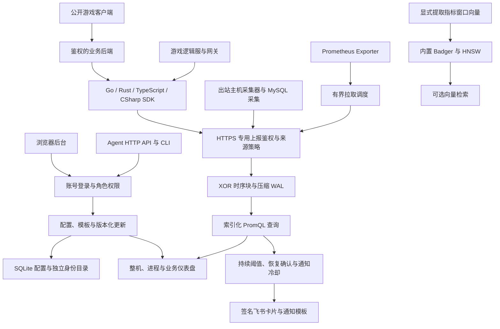

# metrics233-all

[English](README.md) · **简体中文**

单机主机与游戏业务监控：一个服务端，独立版本的 Go、Rust、TypeScript、C# 上报 SDK。

## 架构



时序观测默认写入压缩 TSDB，不再由一个 OLTP 行表承担全部存储。SQLite 单独保存配置和账号，向量引擎按需用于指标窗口；不依赖外置数据库。指标默认保留 **15 天**，可以调整；清理指标不删除账号和监控配置。

## 页面分工

| 页面 | 看什么 |
| --- | --- |
| 概览 | 监控服务本身的运行状态。 |
| 仪表盘 | 真正上报数据的服务器：整机 CPU/内存/磁盘、服务进程 CPU/RSS/运行时长、游戏与网关业务。 |
| 模板中心 | 可复用的业务面板；多个实例继承同一模板，也可另存独立副本。 |
| 玩家地区 | 全部地区统计，使用虚拟列表。 |
| 慢 SQL Top10 | 异步合并后的真实数据库执行次数、加权耗时和多重排序。 |
| 元数据 | 采集器、上报来源、主机管理。 |

主机关联由管理员明确保存，共用公网出口不自动认作同一主机。业务实例按 environment、channel、service、role、serverId、instance、implementation 完整区分，不改写原有自定义模板。

SQL 和地区表支持最多 **5 重排序**：点击表头选择主排序，Shift + 点击追加次排序，也可编辑优先级和方向。服务端先排序完整的有界结果集，再分页或取前10；缺失值始终放最后。默认查看最近 **60 分钟**。

## 子模块

| 子仓库 | 职责 |
| --- | --- |
| [metrics233-server](https://github.com/neko233-com/metrics233-server) | Go 服务端、原生 React 面板、采集器、压缩时序、内置向量和告警。 |
| [metrics233-lib-go](https://github.com/neko233-com/metrics233-lib-go) | 仅标准库的 Go 链式指标与主动上报。 |
| [metrics-lib-rust](https://github.com/neko233-com/metrics-lib-rust) | 已发布的 `metrics233 0.1.0`，Rust 1.88+。 |
| [metrics233-client-sdk-typescript](https://github.com/neko233-com/metrics233-client-sdk-typescript) | TypeScript / Node 18+ ESM，零运行时依赖；Counter、Gauge、原始记录。 |
| [metrics233-client-sdk-csharp](https://github.com/neko233-com/metrics233-client-sdk-csharp) | `Metrics233.Client`；.NET Standard 2.0、.NET 8、.NET 10；Counter、Gauge。 |
| [metrics233-client-sdk-rust](https://github.com/neko233-com/metrics233-client-sdk-rust) | 统一命名入口，复用同一份已验证的 Rust 传输实现。 |

```sh
git clone --recurse-submodules https://github.com/neko233-com/metrics233-all.git
cd metrics233-all
# 已有 checkout：
git submodule update --init --recursive
```

父仓库固定全部公共子模块的精确提交。应用源码、上报 SDK 与独立受控的私有部署仓库分开管理；生产地址、凭据和部署配置不进入公共聚合仓库。

## 启动

```sh
cd metrics233-server/web
npm ci
npm run build
cd ..
go build -tags webui -o bin/metricspanel ./cmd/metricspanel
./bin/metricspanel serve --auth=local --listen=127.0.0.1:7333 --open
```

UI 嵌入单个可执行文件。公网使用 HTTPS 代理、loopback 监听和明确的可信代理配置。**后台账号登录与主动上报 Token 分离**；上报 Token 不能查询或管理后台。公开浏览器和游戏客户端通过业务后端中转，不向玩家发放永久服务端 Token。

## SDK 安装与使用

原 Rust 传输库可以从 crates.io 正式安装：

```sh
cargo add metrics233@0.1.0
```

统一命名的 SDK 使用各自仓库与版本化 GitHub 安装包。Rust 也可直接使用固定 Git 版本：

```sh
cargo add metrics233-client-sdk-rust --git https://github.com/neko233-com/metrics233-client-sdk-rust.git --tag v0.1.0
```

TypeScript 的 `.tgz` 可用 `npm install <安装包文件或URL>`；C# 的 `Metrics233.Client.0.1.0.nupkg` 可放入本地 NuGet 源安装。用法、容量和鉴权边界见各 SDK README。GitHub 安装包与 npm/NuGet/crates.io 上架分别验收；新 Rust 别名包当前仍需要有效的注册表发布凭据。

SDK 构造不联网、不读环境变量、不自动启动任务；需要定时发送时显式启动，退出前等待刷新和关闭。Counter 累加增量，Gauge 保存最新值；队列和请求体有上限，未确认批次保留原时间戳。运行时长用数字展示，进程 CPU 标明“单核占比”，不与整机使用率混淆。

## 告警与 HTTP 运维

CPU、内存、磁盘必须持续超阈值才提醒，分别配置恢复阈值、恢复持续时间和 **1 小时通知冷却**。绿/黄/红表示当前风险，不等于已经发出通知。飞书支持签名卡片、清晰的用量和处理建议、可自定义的有界模板与不发送的预览。

登录后访问 `GET /api/v1/agent/capabilities` 可发现原生 HTTP 操作、角色与并发规则。Agent 按“读取现状 → 预览 → 带版本保存 → 回读 → 验证运行”执行；来源 IP 策略独立于上报标签。

## 验证边界

压缩存储和六个上报实例的资源视图已有真实线上验收；三个 SDK 有隔离的真实服务上报与全新消费者检查。源码、安装包、GitHub、注册表、浏览器和生产发布分别记录，不把构建或排队当作上线成功。

- [交付记录](docs/status.md)与[执行计划](PLAN.md)
- [服务架构](https://github.com/neko233-com/metrics233-server/blob/main/docs/architecture.md)
- [压缩存储](https://github.com/neko233-com/metrics233-server/blob/main/docs/embedded-storage.md)
- [实例仪表盘与排序](https://github.com/neko233-com/metrics233-server/blob/main/docs/business-instances.md)
- [上报鉴权](https://github.com/neko233-com/metrics233-server/blob/main/docs/reporting-access.md)
- [通知冷却](https://github.com/neko233-com/metrics233-server/blob/main/docs/alert-notification-cooldown.md)

昂贵 CI 仅由版本 tag 或手动触发。推送源码与生产部署是两件事，精确运行源码及实际验收层级以交付记录为准。
