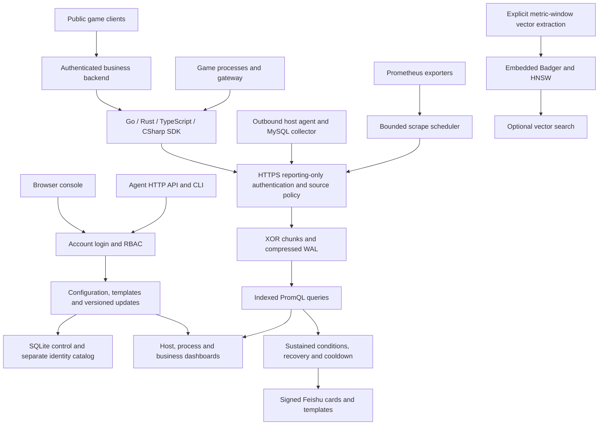

# metrics233-all

**English** · [简体中文](README-CN.md)

A small, single-node server for host and game-service monitoring, with independently versioned reporting SDKs.

## Architecture



Time series do not use one OLTP row per observation by default. The embedded TSDB stores metrics; SQLite stores configuration and accounts separately, and the local vector engine is opt-in for metric windows. No external database is needed. Retention defaults to **15 days** and is configurable; account and monitoring settings survive metric expiration.

## What to open

| Page | Purpose |
| --- | --- |
| Overview | The monitoring service's own runtime. |
| Dashboards | Reporting servers: physical CPU/memory/disk, process CPU/RSS/uptime, gateway and game metrics. |
| Template center | Shared business-panel templates or independent custom layouts. |
| Player regions | Complete region statistics with virtualized rows. |
| Slow SQL Top10 | Actual database calls after async merging, weighted latency and configurable multi-column ranking. |
| Metadata | Collectors, reporting sources and managed hosts. |

Host relationships are explicitly confirmed by an administrator. Sharing a public IP never makes two instances the same machine. Environment, channel, service, role, serverId, instance and implementation scope every business view. Existing customized templates are preserved.

SQL and region tables support up to **five ordered sort rules**: click a header for the primary sort, Shift-click for another, or edit priority/direction. The server sorts the complete bounded result before pagination or Top10; missing values remain missing. The default window is **60 minutes**.

## Modules

| Submodule | Contract |
| --- | --- |
| [metrics233-server](https://github.com/neko233-com/metrics233-server) | Go server, first-party React panels, collectors, compressed TSDB, local vectors and alerts. |
| [metrics233-lib-go](https://github.com/neko233-com/metrics233-lib-go) | Standard-library-only Go instrumentation and push reporting. |
| [metrics-lib-rust](https://github.com/neko233-com/metrics-lib-rust) | Published `metrics233 0.1.0` transport; Rust 1.88+. |
| [metrics233-client-sdk-typescript](https://github.com/neko233-com/metrics233-client-sdk-typescript) | TypeScript/Node 18+ ESM, zero runtime dependencies; Counter/Gauge/raw records. |
| [metrics233-client-sdk-csharp](https://github.com/neko233-com/metrics233-client-sdk-csharp) | `Metrics233.Client`; .NET Standard 2.0 / .NET 8 / .NET 10; Counter/Gauge. |
| [metrics233-client-sdk-rust](https://github.com/neko233-com/metrics233-client-sdk-rust) | Unified Rust name re-exporting the same verified `metrics233` transport. |

```sh
git clone --recurse-submodules https://github.com/neko233-com/metrics233-all.git
cd metrics233-all
# Existing clone:
git submodule update --init --recursive
```

The aggregate pins exact public child commits. The application source, reporting SDKs and separately controlled private deployment repository have distinct lifecycles. Production addresses, credentials and deployment configuration do not belong in this public aggregate.

## Run the server

```sh
cd metrics233-server/web
npm ci
npm run build
cd ..
go build -tags webui -o bin/metricspanel ./cmd/metricspanel
./bin/metricspanel serve --auth=local --listen=127.0.0.1:7333 --open
```

The UI is embedded in the executable. For public access, use an HTTPS proxy, loopback binding and an explicit trusted-proxy configuration. Backend login uses accounts; business reporters use a **different ingest-only token**. Reporting credentials cannot read dashboards or configure the server. Public browser/game clients use their authenticated business backend as a relay; do not distribute permanent server tokens to players.

## Install reporting clients

The original Rust transport is available from crates.io:

```sh
cargo add metrics233@0.1.0
```

The unified SDKs have independent source repositories and versioned GitHub packages. Rust can also use its fixed Git source:

```sh
cargo add metrics233-client-sdk-rust --git https://github.com/neko233-com/metrics233-client-sdk-rust.git --tag v0.1.0
```

TypeScript installs its GitHub `.tgz` with `npm install <package-file-or-URL>`. CSharp installs `Metrics233.Client.0.1.0.nupkg` from a local NuGet feed. See each module's README for lifecycle, capacity, HTTPS and authentication contracts. Registry uploads are separate from GitHub/package publication; the new Rust alias currently needs valid publication credentials.

All SDKs are inert on construction. Explicitly start periodic delivery if needed and await flush/shutdown. Counter increments are cumulative, Gauge keeps the latest value, queues and payloads are bounded, and unacknowledged batches retain their timestamps. Uptime is a number, and process CPU explicitly uses one-core percent instead of being confused with whole-host usage.

## Alerting and HTTP operations

CPU/memory/disk rules distinguish a brief spike from a sustained problem, use a separate recovery threshold/duration and a **1-hour notification cooldown**. Green/amber/red indicate current resource risk, not proof a message was sent. Feishu cards support signed delivery, human-readable context, custom bounded templates and no-send preview.

Authenticated `GET /api/v1/agent/capabilities` documents native operations, roles and concurrency rules. Agents read current state, preview, save with the supported version precondition, then read back and verify runtime behavior. Source IP allow/block policy is independent of reporter-supplied labels.

## Verification

The status ledger separates local tests, package installation, GitHub/registry availability, browser evidence and production deployment. The compressed storage and six reporting-instance resource views have real online acceptance; SDKs additionally pass isolated real-server ingestion and fresh consumer checks. Tests never require distributing production credentials.

- [Delivery evidence](docs/status.md) and [execution plan](PLAN.md)
- [Server architecture](https://github.com/neko233-com/metrics233-server/blob/main/docs/architecture.md)
- [Embedded storage](https://github.com/neko233-com/metrics233-server/blob/main/docs/embedded-storage.md)
- [Business instances and sorting](https://github.com/neko233-com/metrics233-server/blob/main/docs/business-instances.md)
- [Reporting authentication](https://github.com/neko233-com/metrics233-server/blob/main/docs/reporting-access.md)
- [Notification cooldown](https://github.com/neko233-com/metrics233-server/blob/main/docs/alert-notification-cooldown.md)

Expensive CI runs only for version tags or manual dispatch. A source push is not a production deployment; the exact runtime source and acceptance layer are recorded in the ledgers.
